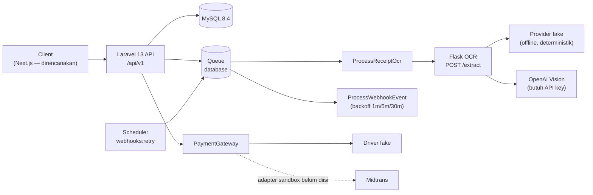

<div align="center">

# AmanahLink

**Purpose-Bound Donation Platform**

Dana donasi tidak dicairkan menjadi uang tunai. Dana menjadi limit pembayaran yang terikat kategori merchant, tercatat di ledger double-entry, dan setiap rupiah dapat direkonsiliasi.

[](https://www.php.net/)
[](https://laravel.com/)
[](https://www.mysql.com/)
[](https://flask.palletsprojects.com/)
[](#testing)
[](#status--roadmap)

[Repo](https://github.com/Dikaaff/AmanahLink) · [Dokumentasi](#dokumentasi) · [Mulai cepat](#memulai)

</div>

---

## Daftar Isi

- [Tentang Proyek](#tentang-proyek)
- [Status & Roadmap](#status--roadmap)
- [Fitur](#fitur)
- [Arsitektur](#arsitektur)
- [Teknologi](#teknologi)
- [Struktur Repo](#struktur-repo)
- [Memulai](#memulai)
- [Konfigurasi](#konfigurasi)
- [API](#api)
- [Aturan Bisnis & Model Keamanan](#aturan-bisnis--model-keamanan)
- [Testing](#testing)
- [Dokumentasi](#dokumentasi)
- [Batasan yang Diketahui](#batasan-yang-diketahui)
- [Konvensi Kontribusi](#konvensi-kontribusi)
- [Lisensi & Kredit](#lisensi--kredit)

---

## Tentang Proyek

Platform donasi konvensional mencairkan dana ke rekening penggalang. Setelah dana berpindah, platform kehilangan kendali atas penggunaannya: dana medis bisa dipakai membeli barang elektronik, dana pendidikan bisa dipakai konsumsi pribadi. Donatur hanya menerima laporan manual yang tidak dapat diverifikasi.

**AmanahLink membalik model itu.** Dana donasi:

1. **Terikat kategori, bukan orang** — hanya dapat dibelanjakan di merchant terverifikasi yang MCC-nya linier dengan tujuan kampanye.
2. **Berjejak per rupiah** — `donation → ledger → disbursement → receipt → reconciliation`, semuanya dapat direkonsiliasi ulang dari ledger.
3. **Dikembalikan otomatis** — sisa dana saat kampanye ditutup direfund proporsional ke donatur.

### Batas kejujuran klaim

> Pada MVP ini, MCC ditegakkan melalui **registrasi merchant terverifikasi + validasi `allowed_mcc_array` saat authorize**, bukan klaim "diblokir oleh jaringan". Sistem tidak menyediakan kartu virtual ber-MCC di level issuer. Semua materi demo dan UI harus memakai frasa **"merchant terverifikasi + kategori transaksi"**, bukan "diblokir oleh jaringan" (lihat `DECISIONS.md` D-002 dan D-003).

---

## Status & Roadmap

Proyek berada pada tahap **backend MVP**. Sumber kebenaran status ada di [`docs/progress.md`](docs/progress.md).

| Fase | Cakupan | Status |
|---|---|---|
| 0 — Discovery | PRD, backlog, keputusan arsitektur | ✅ selesai |
| 2 — Arsitektur & Data | migration, enum, model, factory, seeder, invariant test | ✅ selesai |
| 3 — API & Ledger | auth/RBAC, kampanye, donasi, webhook, disbursement, refund | ✅ selesai |
| 4 — OCR Service | Flask `/extract`, upload nota, auto-match, review manual | ✅ selesai |
| 5 — Frontend | halaman Next.js | ⬜ belum |
| 6 — Security | hardening + checklist ASVS | ⬜ belum |
| 7 — Test Suite | k6, konkurensi, E2E | ⬜ belum |
| 8 — DevOps | compose, CI, observability, runbook | ⬜ belum |

**Story yang sudah selesai:** US-01 … US-29 (seluruh backlog MVP).
**Berikutnya:** Fase 5 — frontend Next.js, lalu security, test suite, dan DevOps.

---

## Fitur

### Autentikasi & Otorisasi
- Registrasi dan login dengan **Laravel Sanctum** (bearer token).
- Empat role: `donor`, `campaigner`, `verifier`, `admin`.
- RBAC dan kepemilikan resource ditegakkan lewat **Policy**, bukan filter query di controller.
- Rate limiting login/registrasi dan lockout berbasis throttle.

### Siklus Kampanye
- Draft → review → active/funded → frozen/expired → closed → refunded.
- `allowed_mcc_array` divalidasi terhadap registry MCC (deny-by-default).
- Edit dikunci setelah donasi pertama settle.
- Approve/reject dengan alasan, freeze/unfreeze dengan alasan tersimpan, tutup kampanye + refund sisa.
- Halaman publik kampanye dengan progress dan label kategori.

### Donasi & Pay-in
- VA/QRIS melalui interface `PaymentGateway` dengan driver `fake` deterministik.
- **Idempotency-Key** per pengguna, payload di-hash, replay mengembalikan body identik.
- Webhook settlement dengan **HMAC-SHA256**, toleransi timestamp 5 menit, deduplikasi `external_id`, dan audit setiap penolakan.
- Fee platform 2% dicatat sebagai transaksi terpisah.
- **Retry & dead-letter:** event gagal dicoba ulang dengan backoff 1m/5m/30m oleh `webhooks:retry`; setelah itu masuk DLQ dan hanya bisa di-replay admin (idempoten).

### Notifikasi
- Perubahan state kampanye (approve, reject, freeze, unfreeze) menulis baris `notifications` untuk pemilik kampanye.
- Email dikirim lewat **queue** (`CampaignStateChangedMail`), terpisah dari baris in-app.
- `GET /notifications`, tandai satu, atau tandai semua sebagai dibaca (`read_at`).

### Disbursement & Ledger
- Limit harian/bulanan/kedaluwarsa per kampanye.
- Validasi merchant terverifikasi + MCC + MCC global aktif/tidak diblokir.
- Cek saldo dari **ledger**, bukan hanya kolom cache.
- Anti double-spend lewat row lock dan invariant check dalam satu transaksi DB.
- Ledger double-entry immutable (model event + trigger MySQL).

### Nota & OCR
- Upload nota (JPEG/PNG) ke private storage, diproses job queue.
- Service Flask `POST /extract` dengan kontrak JSON tetap; provider `fake` offline atau `openai` bila key tersedia.
- Auto-match hanya jika confidence ≥ 0,75, nominal ±1%, dan merchant ada di registry dengan MCC yang diizinkan.
- Selain itu masuk `needs_review`; timeout OCR tidak pernah menjadi HTTP 500.
- Queue review manual untuk verifikator, approve → transaksi `reconciled`, reject → `disputed`.

### Admin & Audit
- Dashboard monitoring: total settled/disbursed/refund, saldo dari ledger vs cache, jumlah mismatch, antrean OCR, dan p95 latency authorize 24 jam.
- Freeze/unfreeze kampanye tanpa membatalkan disbursement yang sudah `captured`.
- Audit log viewer read-only dengan filter actor/action/tanggal dan cursor pagination.
- `PUT/PATCH/DELETE /audit-logs/{id}` selalu `405`; audit row tidak dapat diubah atau dihapus.
- Webhook event viewer untuk admin dengan filter status/provider, plus replay dari dead-letter queue.

---

## Arsitektur



**Prinsip arsitektur**

| Prinsip | Implementasi |
|---|---|
| Domain tidak tahu vendor | `App\Contracts\PaymentGateway`, `App\Contracts\ReceiptOcr` dengan driver `fake` dan adapter nyata |
| Ledger adalah sumber kebenaran | Saldo kampanye dihitung dari `ledger_entries`; `campaigns.current_amount` hanya cache yang diverifikasi ulang |
| Uang tidak pernah float | `DECIMAL(15,2)` + string + `brick/math` (`App\Support\Money`) |
| Idempotensi di database | Unique key + row lock; replay mengembalikan body tersimpan |
| Audit tidak bisa hilang | `audit_logs` append-only, ledger immutable di model dan trigger DB |
| Offline-first untuk test | Semua integrasi eksternal punya driver `fake` deterministik |

### Akun Ledger

| Kode | Nama | Tipe | Normal |
|---|---|---|---|
| `1000` | Platform Cash | asset | debit |
| `2050` | Refund Payable | liability | credit |
| `2100` | Merchant Clearing | liability | credit |
| `2200` | Campaign Restricted Funds (`campaign:{id}`) | liability | credit |
| `4000` | Platform Fee Revenue | revenue | credit |

### Alur Ledger

| Kejadian | Debit | Kredit |
|---|---|---|
| Donasi settle Rp100.000 | `1000` Cash 100.000 | `2200` Restricted 100.000 |
| Fee platform 2% | `2200` Restricted 2.000 | `4000` Fee Revenue 2.000 |
| Disburse Rp50.000 | `2200` Restricted 50.000 | `2100` Merchant Clearing 50.000 |
| Refund sisa per donatur | `2200` Restricted | `2050` Refund Payable |
| Payout refund | `2050` Refund Payable | `1000` Cash |

**Invariant yang diuji, bukan diklaim:**

1. Σ debit = Σ kredit untuk setiap `transaction_id`.
2. `campaigns.current_amount` = saldo akun `2200` kampanye (diverifikasi ulang setiap mutasi).
3. Tidak ada transaksi `captured` tanpa tepat dua baris ledger.

---

## Teknologi

| Lapisan | Teknologi | Versi |
|---|---|---|
| Bahasa backend | PHP (ZTS) | 8.3.30 |
| Framework | Laravel | 13.39.0 |
| Auth API | Laravel Sanctum | 4.3 |
| Aritmetika uang | brick/math | 1.x |
| Database | MySQL | 8.4.3 |
| Test backend | PHPUnit | 12.5 |
| Formatter | Laravel Pint | 1.27 |
| OCR service | Python + Flask | 3.12 / 3.1 |
| OCR provider | OpenAI Vision (opsional) | `gpt-4o-mini` default |
| Queue | Database driver | — |

> Frontend Next.js belum dibuat. Fase 5 akan memakai API yang sudah tersedia.

---

## Struktur Repo

```text
AmanahLink/
├── backend/                     # Laravel 13 API
│   ├── app/
│   │   ├── Contracts/           # PaymentGateway, ReceiptOcr
│   │   ├── Enums/               # status, role, akun, tipe transaksi
│   │   ├── Exceptions/          # exception domain → error envelope
│   │   ├── Http/
│   │   │   ├── Controllers/Api/V1/
│   │   │   ├── Middleware/      # AssignRequestId
│   │   │   ├── Requests/        # validasi + otorisasi
│   │   │   └── Resources/       # bentuk response API
│   │   ├── Jobs/                # ProcessReceiptOcr
│   │   ├── Models/
│   │   ├── Policies/
│   │   ├── Services/            # ledger, donasi, disbursement, refund, receipt, OCR
│   │   └── Support/             # Money, ApiError, PaymentInstruction
│   ├── config/amanahlink.php    # fee, limit donasi, payment, webhook, OCR
│   ├── database/                # 17 migration, factory, seeder
│   ├── routes/api.php           # seluruh endpoint /api/v1
│   └── tests/                   # PHPUnit feature + unit
├── ocr-service/                 # Flask OCR boundary
│   ├── app.py                   # GET /healthz, POST /extract
│   ├── tests/test_extract.py    # contract test
│   ├── Dockerfile
│   └── requirements.txt
├── docs/
│   ├── prd.md                   # problem, FR/NFR, state machine, error catalog
│   ├── backlog.md               # 29 user story + AC Gherkin
│   └── progress.md              # status eksekusi per fase/story (sumber kebenaran)
├── DECISIONS.md                 # register keputusan D-001 … D-019
└── README.md
```

---

## Memulai

### Prasyarat

- PHP **8.3+** dengan ekstensi `pdo_mysql`, `mbstring`, `openssl`, `fileinfo`
- Composer 2
- MySQL **8.4+** (proyek ini **tidak** memakai SQLite — lihat D-010)
- Python **3.12+** (untuk service OCR)
- Git

### 1. Clone

```bash
git clone https://github.com/Dikaaff/AmanahLink.git
cd AmanahLink
```

### 2. Siapkan database

```sql
CREATE DATABASE amanahlink
  CHARACTER SET utf8mb4
  COLLATE utf8mb4_unicode_ci;

CREATE DATABASE amanahlink_test
  CHARACTER SET utf8mb4
  COLLATE utf8mb4_unicode_ci;
```

`amanahlink_test` dipakai oleh test suite (lihat `backend/phpunit.xml`; sesuaikan user/password bila berbeda dari `root` tanpa password).

### 3. Backend

```bash
cd backend
composer install
cp .env.example .env
php artisan key:generate
```

Sesuaikan `.env`:

```dotenv
APP_URL=http://localhost:8000

DB_CONNECTION=mysql
DB_HOST=127.0.0.1
DB_PORT=3306
DB_DATABASE=amanahlink
DB_USERNAME=root
DB_PASSWORD=

AMANAH_PAYMENT_WEBHOOK_SECRET=ganti-dengan-rahasia-acak
```

Lalu migrasi dan seed:

```bash
php artisan migrate --seed
```

Seeder membuat registry MCC, merchant demo, kampanye demo, serta akun berikut (**hanya untuk lokal/demo**):

| Email | Role | Password |
|---|---|---|
| `admin@amanahlink.test` | admin | `password` |
| `budi@amanahlink.test` | campaigner | `password` |
| `siti@amanahlink.test` | donor | `password` |

> Ganti atau hapus akun demo sebelum deployment apa pun.

### 4. Jalankan API

```bash
php artisan serve
```

API tersedia di `http://127.0.0.1:8000/api/v1`. Cek kesehatan framework di `/up`.

Karena proses OCR memakai queue, jalankan worker di terminal terpisah:

```bash
php artisan queue:work
```

> Di test, `QUEUE_CONNECTION=sync` sehingga job berjalan inline.

### 5. Service OCR (opsional untuk pengembangan)

Driver default `fake` berjalan tanpa service. Untuk memakai batas OCR sungguhan:

```bash
cd ocr-service

# Windows
python -m venv .venv
.venv\Scripts\activate
pip install -r requirements.txt

# Linux/macOS
# python3 -m venv .venv && source .venv/bin/activate
# pip install -r requirements.txt

python app.py          # http://127.0.0.1:5001
```

Lalu di `backend/.env`:

```dotenv
AMANAH_OCR_DRIVER=http
AMANAH_OCR_SERVICE_URL=http://127.0.0.1:5001
```

Untuk provider vision nyata, jalankan service dengan:

```dotenv
OCR_PROVIDER=openai
OPENAI_API_KEY=sk-...
OPENAI_MODEL=gpt-4o-mini
```

Jalankan test service:

```bash
cd ocr-service
.venv/Scripts/python -m pytest -q     # Windows
# .venv/bin/python -m pytest -q       # Linux/macOS
```

---

## Konfigurasi

### Backend (`backend/.env`)

| Variabel | Default | Keterangan |
|---|---|---|
| `AMANAH_PLATFORM_FEE_PERCENT` | `2.00` | Fee platform saat settlement, tidak dipotong ulang saat refund |
| `AMANAH_MIN_DONATION` | `10000.00` | Nominal donasi minimum per transaksi |
| `AMANAH_MAX_DONATION` | `1000000000.00` | Nominal donasi maksimum |
| `AMANAH_PAYMENT_DRIVER` | `fake` | Driver `PaymentGateway` (`fake` saat ini satu-satunya) |
| `AMANAH_PAYMENT_EXPIRY_HOURS` | `24` | Masa berlaku instruksi pembayaran |
| `AMANAH_PAYMENT_WEBHOOK_SECRET` | *(kosong)* | HMAC secret. Kosong = semua webhook ditolak |
| `AMANAH_PAYMENT_WEBHOOK_TOLERANCE` | `300` | Toleransi timestamp webhook (detik) |
| `AMANAH_OCR_DRIVER` | `fake` | `fake` (offline) atau `http` (Flask) |
| `AMANAH_OCR_SERVICE_URL` | `http://127.0.0.1:5001` | Base URL service OCR |
| `AMANAH_OCR_TIMEOUT` | `10` | Timeout request OCR (detik) |
| `AMANAH_OCR_CONFIDENCE` | `0.75` | Ambang confidence untuk auto-match |
| `AMANAH_OCR_AMOUNT_TOLERANCE` | `1` | Toleransi nominal OCR (persen) |
| `AMANAH_RECEIPT_MAX_BYTES` | `5242880` | Ukuran maksimum nota (5 MB) |

### Service OCR

| Variabel | Default | Keterangan |
|---|---|---|
| `OCR_PROVIDER` | `fake` | `fake` atau `openai` |
| `OPENAI_API_KEY` | — | Wajib untuk provider `openai` |
| `OPENAI_MODEL` | `gpt-4o-mini` | Model vision |
| `OCR_REQUEST_TIMEOUT` | `25` | Timeout request ke provider (detik) |
| `PORT` | `5001` | Port server saat dijalankan langsung |

---

## API

- **Base URL:** `/api/v1`
- **Auth:** `Authorization: Bearer <token>` (Sanctum)
- **Content-Type:** `application/json` (kecuali upload nota: `multipart/form-data`)
- **Uang:** selalu string desimal dua angka, mis. `"100000.00"` — bukan float
- **Trace ID:** setiap error envelope menyertakan `trace_id` yang bisa dicocokkan dengan log

### Error Envelope

```json
{
  "error": {
    "code": "MCC_NOT_ALLOWED",
    "message": "Kategori merchant tidak termasuk daftar yang diizinkan kampanye ini.",
    "details": {},
    "trace_id": "01J..."
  }
}
```

<details>
<summary><strong>Katalog error code</strong></summary>

| Code | HTTP | Kapan |
|---|---|---|
| `VALIDATION_ERROR` | 422 | Input gagal validasi; `details.fields` |
| `UNAUTHENTICATED` | 401 | Token tidak ada/invalid |
| `INVALID_SIGNATURE` | 401 | Signature atau timestamp webhook tidak sah |
| `EMAIL_UNVERIFIED` | 403 | Aksi sensitif sebelum verifikasi |
| `FORBIDDEN` | 403 | Role/ownership tidak berhak |
| `MCC_NOT_ALLOWED` | 403 | MCC di luar allowlist atau merchant belum terverifikasi |
| `INSUFFICIENT_FUNDS` | 409 | Saldo ledger < nominal |
| `LIMIT_EXCEEDED` | 409 | Batas harian/bulanan terlampaui |
| `LIMIT_EXPIRED` | 409 | Limit pencairan kedaluwarsa/belum diatur |
| `CAMPAIGN_NOT_ACTIVE` | 409 | Status kampanye tidak menerima donasi/pencairan |
| `CAMPAIGN_LOCKED` | 409 | Edit setelah donasi pertama settle |
| `CONFLICT_STATE` | 409 | Transisi state terlarang |
| `DUPLICATE_REQUEST` | 409 | Key idempotensi masih in-flight |
| `IDEMPOTENCY_MISMATCH` | 422 | Key sama, payload berbeda |
| `OCR_LOW_CONFIDENCE` | 422 | Ekstraksi gagal total |
| `RATE_LIMITED` | 429 | Kuota terlampaui; ada `Retry-After` |
| `NOT_FOUND` | 404 | Resource tidak ada |
| `METHOD_NOT_ALLOWED` | 405 | Mutasi audit log / metode salah |
| `UPSTREAM_TIMEOUT` | 504 | Provider eksternal timeout |
| `INTERNAL_ERROR` | 500 | Fallback; tanpa stack trace |

</details>

### Endpoint

| Method | Endpoint | Akses | Keterangan |
|---|---|---|---|
| `POST` | `/auth/register` | publik | Throttle 10/menit; role dipaksa `donor` |
| `POST` | `/auth/login` | publik | Throttle 20/menit; lockout 5 kegagalan |
| `POST` | `/auth/logout` | token | Cabut token aktif |
| `GET` | `/auth/me` | token | Profil aktor |
| `GET` | `/campaigns` | publik | Offset pagination, filter `q` |
| `GET` | `/campaigns/{slug}` | publik | Draft hanya owner/staff |
| `GET` | `/campaigns/mine` | token | Kampanye milik aktor |
| `POST` | `/campaigns` | campaigner/admin | Draft + `allowed_mcc_array` |
| `PUT` | `/campaigns/{id}` | owner/admin | Dikunci setelah donasi settle |
| `POST` | `/campaigns/{id}/submit` | owner | Draft → pending review |
| `POST` | `/campaigns/{id}/review` | verifier/admin | Approve/reject + alasan |
| `POST` | `/campaigns/{id}/freeze` | admin | Alasan wajib |
| `POST` | `/campaigns/{id}/unfreeze` | admin | Kembali ke `active`/`funded` |
| `POST` | `/campaigns/{id}/close` | admin | Tutup + refund sisa dana |
| `PUT` | `/campaigns/{id}/disbursement-limit` | admin | Limit harian/bulanan/expiry |
| `POST` | `/donations` | token + `Idempotency-Key` | Membuat VA/QRIS |
| `GET` | `/donations` | token | Riwayat donasi sendiri |
| `POST` | `/disbursements` | owner/admin + `Idempotency-Key` | Authorize + capture |
| `POST` | `/disbursements/{transaction}/receipts` | owner/admin | Multipart `file` (JPEG/PNG) |
| `GET` | `/receipts` | verifier/admin | Filter `status`, mis. `needs_review` |
| `POST` | `/receipts/{receipt}/review` | verifier/admin | Approve/reject nota |
| `GET` | `/notifications` | token | Inbox sendiri; `?unread=1`, cursor 25 |
| `POST` | `/notifications/{id}/read` | token | Mengisi `read_at` |
| `POST` | `/notifications/read-all` | token | Tandai semua telah dibaca |
| `GET` | `/admin/dashboard` | admin | Saldo ledger vs cache, mismatch, antrean OCR, p95 authorize |
| `GET` | `/admin/webhook-events` | admin | Filter `status`/`provider`/`external_id`, cursor 25 |
| `POST` | `/admin/webhook-events/{id}/replay` | admin | Replay event `failed`/`dead_letter` (idempoten) |
| `GET` | `/audit-logs` | verifier/admin | Cursor pagination + filter |
| `PUT/PATCH/DELETE` | `/audit-logs/{id}` | — | Selalu `405` (append-only) |
| `POST` | `/webhooks/payments/{provider}` | HMAC | Tanpa bearer token |

### Contoh: membuat donasi

```bash
curl -X POST http://127.0.0.1:8000/api/v1/donations \
  -H "Authorization: Bearer <token>" \
  -H "Idempotency-Key: donation-budi-001" \
  -H "Content-Type: application/json" \
  -d '{"campaign_id": 1, "amount": "100000.00"}'
```

```json
{
  "data": {
    "donation": {
      "id": 1,
      "payment_ref": "PAY-...",
      "status": "initiated",
      "amount": "100000.00"
    },
    "payment": {
      "provider": "fake",
      "payment_ref": "PAY-...",
      "payment_url": "https://sandbox.fake.amanahlink.test/pay/PAY-...",
      "va_number": "8808...",
      "expires_at": "2026-11-03T10:00:00+07:00"
    }
  },
  "meta": { "replayed": false }
}
```

### Idempotensi

- Header `Idempotency-Key` wajib pada `POST /donations` dan `POST /disbursements`.
- Key di-scope per pengguna; payload di-hash kanonik.
- Replay dengan hash sama → **200** + body tersimpan (bukan membuat transaksi baru).
- Key sama, payload berbeda → **422 `IDEMPOTENCY_MISMATCH`**.
- Key masih diproses → **409 `DUPLICATE_REQUEST`**.

### Pagination

| Endpoint | Model |
|---|---|
| `/campaigns`, `/campaigns/mine`, `/donations`, `/receipts` | Offset (`page`, 15 per halaman) |
| `/audit-logs`, `/notifications`, `/admin/webhook-events` | Cursor (`cursor`, 25 per halaman) |

---

## Aturan Bisnis & Model Keamanan

### Matriks izin (ringkas)

| Aksi | donor | campaigner | verifier | admin |
|---|---|---|---|---|
| Lihat kampanye publik | ✓ | ✓ | ✓ | ✓ |
| Buat/edit kampanye | — | ✓ (milik sendiri) | — | — |
| Approve/reject kampanye | — | — | ✓ | ✓ |
| Donasi | ✓ | ✓ | — | — |
| Lihat riwayat donasi sendiri | ✓ | — | — | — |
| Authorize disbursement | — | ✓ (milik sendiri) | — | ✓ |
| Upload nota | — | ✓ (milik sendiri) | — | ✓ |
| Review nota | — | — | ✓ | ✓ |
| Freeze / close kampanye | — | — | — | ✓ |
| Lihat audit log | — | — | ✓ | ✓ |
| Inbox notifikasi | ✓ (sendiri) | ✓ (sendiri) | ✓ (sendiri) | ✓ (sendiri) |
| Lihat/replay DLQ webhook | — | — | — | ✓ |

### Penegakan MCC berlapis

1. **Registry** — merchant hanya `verified` setelah MCC diverifikasi.
2. **Authorize** — `allowed_mcc_array` dicek `in_array(..., true)`, deny-by-default.
3. **Rail** — pada mode allowlist berarti "merchant harus ada di registry"; kontrol issuer hanya jika adapter mendukung.
4. **Rekonsiliasi** — nota OCR + settlement dicocokkan; selisih → `disputed`.

### Integritas uang

- Ledger `append-only`: model menolak update/delete, MySQL trigger `SIGNAL SQLSTATE '45000'` menolak raw update/delete.
- Setiap mutasi saldo berjalan dalam satu DB transaction dengan row lock.
- `campaigns.current_amount` ditulis ulang dari ledger (`CampaignBalanceService::sync`) lalu dibandingkan (`assertConsistent`); selisih membatalkan transaksi.
- Refund membagi sisa saldo dalam satuan sen dengan metode largest-remainder, sehingga Σ refund = saldo ledger persis.

### Webhook

- Signature `X-Callback-Signature: HMAC-SHA256(raw_body, secret)`.
- `timestamp` wajib (ISO-8601 atau Unix detik); selisih > 300 detik ditolak.
- `external_id` unik mencegah double settlement; event gagal masuk `failed`/`dead_letter` (status enum sudah tersedia).
- Penolakan signature/timestamp dicatat ke `audit_logs` (`webhook.rejected`).

---

## Testing

Backend memakai PHPUnit dengan **MySQL** (`amanahlink_test`) dan `RefreshDatabase`; service OCR memakai pytest.

```bash
# Backend
cd backend
php artisan test

# Service OCR
cd ocr-service
.venv/Scripts/python -m pytest -q     # Windows
# .venv/bin/python -m pytest -q       # Linux/macOS
```

Hasil verifikasi terakhir (2026-11-02):

| Suite | Hasil |
|---|---|
| PHPUnit | **142 passed (515 assertions)**, tanpa warning/failure |
| pytest | **8 passed** |

Cakupan utama: auth/RBAC, siklus kampanye, validasi MCC, limit & saldo, idempotensi, replay webhook, invariant ledger, konkurensi double-spend, refund proporsional, upload/auto-match/review nota, freeze/unfreeze, audit viewer, serta kontrak OCR Flask.

Sebelum commit, jalankan formatter:

```bash
cd backend
vendor/bin/pint --format agent <file-yang-diubah>
```

---

## Dokumentasi

| Dokumen | Isi |
|---|---|
| [`docs/prd.md`](docs/prd.md) | Problem, persona, FR/NFR, business rules, state machine, matriks izin, katalog error |
| [`docs/backlog.md`](docs/backlog.md) | 29 user story, acceptance criteria Gherkin, estimasi, traceability FR → US |
| [`docs/progress.md`](docs/progress.md) | **Status eksekusi per fase/story + bukti test + langkah berikutnya** |
| [`DECISIONS.md`](DECISIONS.md) | Register keputusan arsitektur D-001 … D-022 beserta alasan dan alternatif yang ditolak |

> AI/engineer berikutnya: baca `docs/progress.md` dan `DECISIONS.md` sebelum menulis kode, lalu perbarui `docs/progress.md` setelah setiap story selesai.

---

## Batasan yang Diketahui

- **Frontend belum ada.** API siap, tetapi belum ada aplikasi Next.js (Fase 5).
- **Email notifikasi memerlukan queue worker** (`php artisan queue:work`) dan retry webhook memerlukan scheduler (`php artisan schedule:work`). Tanpa keduanya, baris in-app tetap dibuat tetapi email tertunda dan retry tidak berjalan.
- **Alert DLQ > 1000 baru berupa log `critical`** dari `webhooks:retry`; pengiriman alert nyata menunggu observability Fase 8.
- **p95 dashboard mengukur waktu proses aplikasi**, bukan latency jaringan end-to-end; pemangkasan `request_metrics` belum ada (Fase 8).
- **Adapter Midtrans belum diisi.** Hanya driver `fake` yang aktif; interface dan alur webhook sudah siap.
- **Adapter OpenAI OCR belum diuji dengan API key nyata.** Jalur `fake` yang diuji otomatis.
- **Docker belum diverifikasi.** `ocr-service/Dockerfile` ada, tetapi belum pernah di-build karena Docker Desktop belum tersedia di mesin pengembangan; belum ada `docker-compose.yml` (Fase 8).
- **CI/CD belum ada.** Semua verifikasi saat ini dijalankan lokal.
- **NFR availability & backup (NFR-03, NFR-10) belum terverifikasi** sampai ada staging.
- **Single-tenant, IDR saja, tanpa donasi berulang.** Multi-tenant/multi-currency di luar lingkup v1.0.
- **Klaim MCC harus jujur:** mode MVP adalah allowlist registry, bukan kontrol MCC di level jaringan.

---

## Konvensi Kontribusi

1. **Story harus punya AC dan test.** Tidak ada story tanpa test otomatis (Definition of Done di `docs/backlog.md`).
2. **Setiap mutasi state menulis audit log** dan event domain.
3. **Jangan pernah** `UPDATE`/`DELETE` baris ledger atau audit log; gunakan transaksi pembalik.
4. **Uang adalah string.** Jangan pakai `float`, jangan operasikan dengan `+`/`-` PHP langsung; gunakan `App\Support\Money`.
5. **Perubahan arsitektur dicatat** di `DECISIONS.md` dengan alasan dan alternatif yang ditolak.
6. **Perbarui `docs/progress.md`** setiap kali fase/story selesai, sertakan perintah dan hasil test yang benar-benar dijalankan.
7. **Pint + test suite hijau** sebelum commit.

---

## Lisensi & Kredit

Lisensi proyek ini **belum ditetapkan secara eksplisit**. Skeleton Laravel yang menjadi fondasi berlisensi MIT; dependencies lain mengikuti lisensinya masing-masing.

Dibangun oleh [Dikaaff](https://github.com/Dikaaff) dengan Laravel, MySQL, Flask, dan Laravel Boost.
