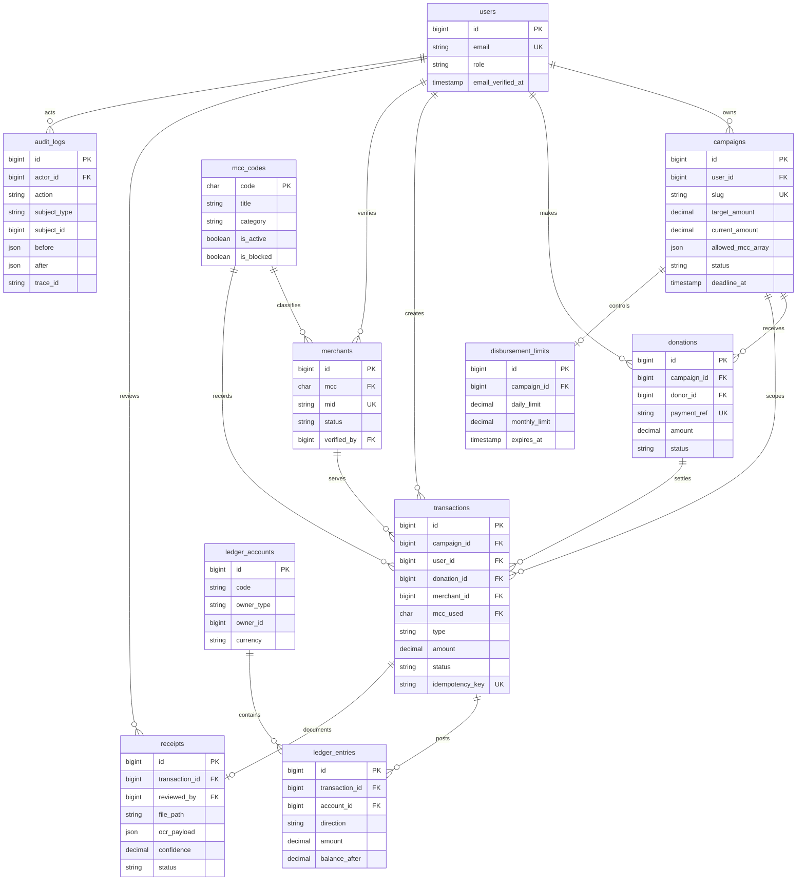

# Entity Relationship Diagram — AmanahLink

**Sumber kebenaran:** migration di `backend/database/migrations/` dan model
Eloquent. Dokumen ini menjelaskan schema yang benar-benar berjalan.

## Diagram inti

## Supporting tables

| Table | Peran | Relasi penting |
|---|---|---|
| `webhook_events` | Payload payment, status retry, dan DLQ | `external_id` unik; dapat diterima sebelum settlement |
| `idempotency_keys` | Lock, request hash, dan response replay | key unik; scope pengguna diterapkan service |
| `personal_access_tokens` | Token Sanctum | polymorphic `tokenable` → `users` |
| `notifications` | Inbox in-app | polymorphic `notifiable` → `users` |
| `request_metrics` | Durasi/status authorize untuk p95 | dipangkas berdasarkan `created_at` |
| `password_reset_tokens`, `sessions` | Infrastruktur Laravel | email/session terkait user |
| `cache`, `cache_locks`, `jobs`, `job_batches`, `failed_jobs` | Cache, lock, dan queue database | tabel infrastruktur tanpa FK domain |

## Invariants dan penghapusan

- Nominal disimpan sebagai `DECIMAL(15,2)`; amount positif ditegakkan check
  constraint pada tabel finansial.
- `ledger_entries` immutable di level model dan trigger MySQL. Koreksi dibuat
  sebagai transaksi pembalik, bukan update/delete.
- `campaigns.current_amount` harus sama dengan saldo akun restricted `2200`.
- FK finansial memakai restrict-on-delete; actor/verifier memakai null-on-delete.
- `ledger_accounts` memakai `(owner_type, owner_id)`, bukan FK polymorphic.
- Audit, metrics, dan webhook events bersifat append-oriented.

## Route-to-entity contract

| Flow | Endpoint aktual | Entity utama |
|---|---|---|
| Campaign draft | `POST /api/v1/campaigns` | `campaigns`, `mcc_codes` |
| Donation pay-in | `POST /api/v1/donations` | `donations`, `idempotency_keys`, `transactions` |
| Payment settlement | `POST /api/v1/webhooks/payments/{provider}` | `webhook_events`, `donations`, `ledger_entries` |
| Disbursement authorize | `POST /api/v1/disbursements` | `transactions`, `merchants`, `disbursement_limits`, `ledger_entries` |
| Disbursement dry-run | `POST /api/v1/disbursements/simulate` | `campaigns`, `merchants`, `disbursement_limits` (baca saja) |
| Receipt upload | `POST /api/v1/disbursements/{transaction}/receipts` | `receipts`, `transactions`, `jobs` |
| Campaign close/refund | `POST /api/v1/campaigns/{campaign}/close` | `campaigns`, `donations`, `ledger_entries` |
