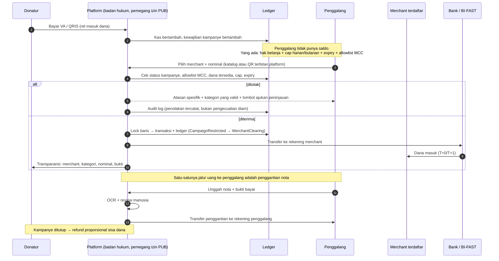

# Alur Dana Donasi AmanahLink — Riset Validasi

**Tanggal:** 2026-11-17
**Status:** riset scoped (bukan legal opinion), dipakai untuk memutuskan kosakata produk dan arsitektur pencairan
**Pemilik keputusan:** pemilik produk AmanahLink

---

## 0. Ringkasan

1. **QRIS bukan rel untuk "platform membayar merchant".** QRIS bersifat *pull*: merchant menampilkan QR, pembayar menarik dana dari sumber dananya sendiri. Tidak ada kemampuan "kirim instruksi ke acquirer supaya merchant X dibayar". Karena itu alur "platform menyetujui lalu acquirer men-settle ke merchant" **tidak bisa dijalankan di atas QRIS**.
2. **Kontrol MCC yang benar-benar mengikat hanya ada di tiga tempat:** (a) platform adalah pihak yang membayar, (b) kartu virtual dengan aturan MCC di sisi penerbit, (c) verifikasi nota setelah uang keluar. QRIS hanya memberi *deteksi*, bukan *kontrol*.
3. **Yang membatasi produk bukan rel pembayaran, tapi izin.** Pengumpulan donasi publik tunduk pada UU 9/1961 + Permensos 8/2021 (diubah Permensos 8/2024); PUB hanya boleh dilakukan lembaga berbadan hukum dan hasilnya wajib dilaporkan. Menyimpan nilai terpakai yang bisa dibelanjakan di banyak merchant = uang elektronik (PBI 20/6/2018) → butuh izin atau mitra penerbit.
4. **Keputusan yang saya rekomendasikan:** MVP = **Model A (merchant terkurasi, platform yang membayar) + Model C (penggantian nota)**, dengan aturan eksplisit "tidak ada uang tunai ke penggalang". Model B (wallet + QRIS) baru masuk lewat mitra penerbit, dan bentuk yang paling terkontrol adalah **kartu virtual ber-MCC**, bukan QRIS.
5. **Kosakata produk harus berubah.** "Cairkan", "saldo", dan "pencairan" menyiratkan uang tunai berpindah ke penggalang. Yang benar: "otorisasi belanja", "dana tersedia", "pembayaran ke merchant", dan "penggantian nota".

---

## 1. Pertanyaan riset dan metode

**Pertanyaan:** Dengan dana donasi yang sudah masuk ke platform, mekanisme apa yang secara teknis dan regulatif sah untuk menyalurkannya ke kebutuhan kampanye, dan bagaimana batas kategori (MCC) ditegakkan?

**Sub-pertanyaan:**
- Apakah QRIS bisa dipakai platform untuk membayar merchant atas nama penggalang?
- Di titik mana aturan MCC benar-benar menolak transaksi?
- Izin apa yang muncul untuk tiap model penyaluran?
- Model mana yang layak untuk MVP tanpa memegang izin pembayaran?

**Metode:** analisis dokumen primer (peraturan BI, UU, Permensos) + dokumen teknis skema (EMVCo/QRIS TLV, kontrol MCC penerbit kartu) + praktik pasar (ketentuan platform donasi Indonesia). Tidak ada wawancara, tidak ada akses dokumen API mitra, tidak ada pendapat hukum.

---

## 2. Temuan

### F1. QRIS adalah rel tarik, bukan rel dorong

QRIS mengikuti spesifikasi EMVCo MPM: payload merchant berisi NMID (template 51) dan MCC (tag 52), lalu pembayar memindai, aplikasi pembayar mendebit sumber dana pembayar, dan acquirer mengkredit merchant. Seluruh inisiasi ada di sisi **pembayar**.
[[EMVCo/QRIS TLV][3], [QRIS decoder][4]]

Fitur "dorong" yang ada di QRIS adalah **QRIS TUNTAS** (transfer antarpengguna, tarik tunai, setor tunai) — dan itu pun transfer ke pengguna/agen, bukan instruksi pembayaran ke merchant arbitrer.
[[BI — QRIS TUNTAS][6]]

> **Konsekuensi:** tidak ada endpoint "bayar merchant QRIS X sebesar Y" bagi pihak ketiga. Kalau platform ingin merchant dibayar, platform harus jadi pihak yang membayar (transfer/BI-FAST) **atau** penggalang membayar sendiri dari instrumen yang dia pegang (e-money/kartu). Tidak ada jalan ketiga.

### F2. Batas QRIS yang berlaku: Rp10 juta per transaksi, plus cap kumulatif dari penerbit

- PADG 21/18/PADG/2019: batas awal Rp2 juta per transaksi; **penerbit boleh menetapkan batas kumulatif harian dan/atau bulanan** per pengguna berdasarkan manajemen risiko. [[BI — PADG 21/18][3]]
- PADG 24/1/PADG/2022: batas per transaksi dinaikkan dari Rp5 juta menjadi **Rp10 juta**, berlaku 1 Maret 2022. [[BI — PADG 24/1/2022][5]]
- Halaman produk QRIS BI mengulang hal yang sama: cap kumulatif adalah kewenangan penerbit, bukan bawaan skema. [[BI — QRIS][2]]

> **Konsekuensi:** "limit" yang kita bangun bukan limit QRIS. Limit QRIS milik penerbit dan berlaku pada instrumen pembayar. Limit AmanahLink adalah **entitlement internal kampanye** (harian/bulanan/expiry) di atas dana yang sudah ada di ledger. Dua hal ini tidak boleh dicampur dalam satu kalimat UI.

### F3. Uang donasi: kewajiban platform, bukan saldo penggalang

Dana donasi masuk ke rekening platform (atau mitra) dan di ledger menjadi dua sisi: kas bertambah, kewajiban terhadap kampanye bertambah. Penggalang tidak memiliki klaim yang bisa ditarik; ia memiliki **hak belanja** yang dibatasi kategori, nominal, dan waktu.

Ini persis yang sudah diimplementasikan: `CampaignRestricted` didebit, `MerchantClearing` dikredit, dengan `DisbursementLimit` (harian/bulanan/expiry) dan `allowed_mcc_array`. [[DisbursementService][repo]]

> **Konsekuensi:** label "saldo" dan "cairkan" salah secara akuntansi maupun hukum. Uang tidak pernah menjadi milik penggalang sampai ada penggantian nota.

### F4. Praktik pasar justru memberi uang tunai ke penggalang — dan itu bukan pelanggaran

Kitabisa menyatakan penggalang dapat mencairkan donasi ke rekening setelah verifikasi, dan untuk kasus medis menyalurkan langsung ke rekening rumah sakit. [[Kitabisa — S&K][8], [Kitabisa — catatan platform][9]]

> **Konsekuensi penting:** klaim "dana donasi tidak pernah cair sebagai cash" adalah **pilihan kebijakan produk AmanahLink**, bukan kewajiban regulasi. Pilihan itu harus dipertahankan dengan alasan (trust, audit, penyaluran tepat guna), bukan dengan alasan "tidak boleh". Dan konsekuensinya harus diterima: kebutuhan non-barang (upah, transport, sewa alat) tidak bisa dibayar lewat merchant, jadi jalur nota wajib ada sejak hari pertama.

### F5. PUB: penyelenggara harus badan hukum, dan ada kewajiban laporan

- Izin PUB diberikan pejabat berwenang berdasarkan UU 9/1961; Menteri Sosial memberi izin setelah mendengar pendapat panitia. [[UU 9/1961][7]]
- Permensos 8/2021 mengatur penyelenggaraan PUB; PUB hanya dapat dilakukan oleh lembaga yang berbadan hukum (bukan individu). [[Populi — policy brief][10], [Dinsos DKI — prosedur PUB][11]]
- Hasil penyelenggaraan PUB wajib dilaporkan kepada bupati/wali kota melalui dinas sosial paling lambat 30 hari sejak selesai penyaluran. [[Leaflet izin PUB — Bantul][12]]
- Permensos 8/2021 telah diubah oleh Permensos 8/2024 (rujukan sekunder; isi perubahan belum diverifikasi baris per baris). [[catatan repositori USU][13]]

> **Konsekuensi arsitektural:** kalau penggalang adalah individu (asumsi A-06 di register), maka **individu itu tidak bisa menjadi penyelenggara PUB**. Yang bertanggung jawab secara hukum adalah badan hukum penyelenggara — dalam skenario kita, platform. Ini memperkuat (bukan melemahkan) model *purpose-bound*: karena platform yang menanggung pertanggungjawaban penggunaan dana, platform butuh kontrol yang bisa dia pertanggungjawabkan, bukan sekadar niat baik penggalang.

### F6. Tiga model penyaluran, dan izin yang benar-benar terpicu

| | Mekanisme | Siapa yang membayar merchant | Izin utama | Kontrol MCC | Jangkauan |
|---|---|---|---|---|---|
| **A. Merchant terkurasi** | Platform mendaftarkan merchant (KYC + rekening), penggalang memilih merchant, platform transfer ke merchant | Platform (BI-FAST/transfer) | PUB (badan hukum); bukan izin pembayaran karena ini pembelian B2B | **Penuh** — merchant tidak ada di registry = tidak bisa dibayar | Hanya merchant terdaftar |
| **B. Wallet + QRIS** | Penggalang pegang nilai terpakai dari penerbit mitra, memindai QRIS merchant | Penerbit mitra, atas inisiasi penggalang | Uang elektronik (PBI 20/6/2018) lewat mitra; platform jadi merchant/agen/penyedia teknologi | **Sebagian** — hanya jika mitra menyediakan validasi merchant *sebelum* eksekusi | Luas, tapi buta MCC setelah bayar |
| **B′. Kartu virtual ber-MCC** | Platform menerbitkan kartu virtual per kampanye lewat penerbit mitra, aturan MCC + nominal + masa berlaku di sisi penerbit | Penerbit kartu | Penerbitan kartu lewat mitra | **Penuh di level otorisasi jaringan** | Merchant penerima kartu |
| **C. Penggantian nota** | Penggalang bayar sendiri, unggah nota + bukti bayar, OCR + review, dana diganti | Platform (reimburse) | PUB; tidak ada izin pembayaran baru | **Setelah kejadian** | Semua vendor, termasuk perorangan |

**Dasar hukum yang relevan:**
- Uang elektronik: PBI 20/6/2018. Izin wajib bagi penerbit *open loop* maupun *closed loop* dengan dana float ≥ Rp1 miliar; pengecualian hanya untuk *closed loop* dengan float di bawah Rp1 miliar. [[BI — PBI 20/6/2018][1]]
- Penyedia jasa pembayaran: PBI 23/6/2021 mengatur kegiatan PJP dan kategori izinnya (modal inti minimum kategori izin satu Rp15 miliar, kategori izin dua Rp5 miliar). [[BI — PBI 23/6/2021][14]]
- Kontrol MCC di level otorisasi adalah kapabilitas penerbit kartu, bukan kapabilitas QRIS. Contoh dokumentasi: Mastercard InControl *MCC control*. [[Mastercard — spend controls][15]]
- Urun dana berbasis teknologi (POJK 57/2020) adalah penerbitan efek, **bukan** donasi; jangan dipakai sebagai dasar legal donasi. [[POJK 57/2020][16]]

### F7. Koreksi terhadap model yang beredar di diskusi tim

| Klaim | Status | Koreksi |
|---|---|---|
| "Platform menyetujui, lalu mengirim instruksi ke acquirer, lalu acquirer settle ke merchant" | **Salah secara teknis** | QRIS tidak punya instruksi dorong ke merchant. Yang ada: platform membayar sendiri (transfer), atau penggalang membayar dari instrumennya. |
| "QRIS adalah produk yang bisa dilimit" | **Salah istilah** | Yang punya limit adalah penerbit atas instrumen pembayar; QRIS hanya standar QR. |
| "MCC dicek saat otorisasi sehingga transaksi ditolak" | **Benar hanya di kartu atau saat platform jadi pembayar** | Di QRIS, MCC dibaca sebelum bayar oleh aplikasi pembayar; menolak di aplikasi kita tidak mencegah pembayaran lewat aplikasi lain. |
| "Model B adalah inti produk, MVP-nya rendah" | **Terbalik** | Model B menuntut mitra penerbit + API pra-bayar yang belum tentu ada. Biaya integrasi dan kepatuhannya paling tinggi; jangkauannya paling luas. |
| "Dana tidak pernah menjadi tunai" | **Pilihan produk, bukan aturan** | Praktik pasar (Kitabisa) memberi opsi pencairan ke rekening penggalang. Bedanya adalah kebijakan risiko, bukan legalitas. |
| PUB tidak disebut sama sekali | **Celah besar** | Penyelenggara PUB harus badan hukum; laporan penggunaan dana wajib. |

### F8. Titik kegagalan yang biasanya baru terasa setelah rilis

1. **Float dan jeda settlement.** Antara otorisasi dan dana masuk ke merchant ada jeda; salah satu pihak menalangi. Harus jelas siapa, dengan plafon berapa.
2. **MCC tidak granular.** Apotek (5912) tetap bisa menjual kosmetik. Tidak ada solusi teknis; yang ada hanya sampling, pelaporan, dan penilaian risiko merchant.
3. **QRIS perorangan.** Banyak vendor kecil memakai QRIS dengan MCC generik. Kategori "makanan/minuman" untuk warung bisa jadi 5812 atau 5499. Registry yang dikurasi (Model A) menghindari masalah ini sepenuhnya.
4. **Kebutuhan non-barang.** Upah harian, transport, sewa alat tidak punya merchant. Tanpa jalur nota, kampanye bencana akan gagal di lapangan.
5. **Beban operasional penolakan.** Setiap penolakan yang tidak menjelaskan "kategori apa yang valid" berubah menjadi tiket ke admin.

---

## 3. Alur yang direkomendasikan (A + C)

Perhatikan: **QRIS hanya muncul di langkah 1** (donatur membayar masuk). Di Model A tidak ada QRIS di sisi keluar dana, karena platform yang membayar. Kalau nanti Model B′ dipakai, kartu virtual muncul di antara penggalang dan merchant — bukan QRIS.

---

## 4. Konsekuensi ke kode dan UX

| Lokasi | Sekarang | Seharusnya |
|---|---|---|
| `frontend/src/app/dashboard/pencairan/page.tsx` | judul "Cairkan dana", alert "Pencairan tercatat", "Saldo ledger" | "Belanja kampanye", "Pembayaran ke merchant tercatat", "Dana tersedia" |
| `frontend/src/app/dashboard/pindai/page.tsx` | "Cairkan dana sekarang?", "Pencairan tidak dapat dibatalkan" | "Otorisasi pembayaran?", "Pembayaran tercatat di ledger dan diteruskan ke merchant" |
| `frontend/src/app/dashboard/nota/page.tsx` | "Nota" | "Penggantian nota" + penjelasan bahwa ini satu-satunya jalur tunai |
| `frontend/src/lib/sections.ts` (`DANA_TABS`) | tab "Dana" | pertimbangkan "Belanja" + "Penggantian" |
| Label limit | "Limit pencairan" | "Batas belanja" + "berlaku sampai" |
| Layar penolakan | kode + pesan | tambah daftar kategori valid + contoh merchant + "Ajukan peninjauan" |
| `backend/app/Services/DisbursementService.php` | sudah benar secara model | tidak perlu ubah logika; hanya nama domain di UI/dokumen |
| `docs/prd.md` baris 19 | "dana donasi tidak pernah cair sebagai cash" | tambahkan "(kebijakan produk, bukan kewajiban regulasi)" |

Catatan: `MerchantClearing` adalah **utang ke merchant** saat instruksi dikirim, bukan bukti dana sudah diterima merchant. Untuk settlement bank nyata T+1, transaksi perlu tahap tambahan. **Sudah diimplementasikan 2026-11-17:** enum `TransactionStatus::Settled` + kolom `transactions.settled_at`; alur `captured → settled → receipt_pending`, driver demo `fake` menyelesaikan transfer secara sinkron sehingga transaksi langsung `settled`, dan transfer yang gagal sebelum dana mendarat dibalik lewat `failSettlement()` (`captured → failed`, jurnal balik, limit dikembalikan, audit `disbursement.settlement_failed`). `settled → failed` sengaja ditolak: koreksi setelah dana mendarat adalah refund/dispute.

**Status implementasi (2026-11-17):** kosakata UI dan label sudah diperbarui di `pencairan`, `pindai`, `nota`, `simulasi`, dasbor, halaman kampanye publik, console admin, `DANA_TABS`, dan `REVIEW_TABS`; spec E2E ikut disesuaikan. Pesan exception/validation backend juga sudah memakai kosakata baru ("dana kampanye tidak mencukupi", "batas harian/bulanan", "pembayaran ke merchant"), dan tahap `settled` sudah ada di skema. Yang **belum** dikerjakan: route rename (ditolak, tetap `/dashboard/pencairan` dan `/dashboard/nota`), plafon nota per nota + 40% kampanye (butuh desain Model C), permintaan merchant baru, dan bundel kategori. Tab "Nota" sengaja tidak diubah menjadi "Penggantian" karena halaman itu melayani dua hal — bukti pembelian (Model A) dan penggantian (Model C).

---

## 5. Pertanyaan wajib ke calon mitra pembayaran

1. Apakah API Anda menyediakan **validasi merchant sebelum pembayaran** (NMID/MCC/status), bukan hanya di callback settlement?
2. Bisakah aturan penolakan dikonfigurasi **per akun/sub-saldo pembayar**, bukan hanya per merchant?
3. Apakah tersedia sub-saldo per kampanye dengan cap dan masa berlaku berbeda?
4. Siapa yang memegang dana float selama kampanye berjalan, dan atas nama siapa rekening dibuka?
5. Berapa lama settlement ke merchant, dan siapa menanggung risiko selama jeda?
6. Apa yang terjadi bila transaksi lolos di sisi Anda tetapi ditolak di sistem kami?
7. Berapa biaya per transaksi pada volume kecil (donasi rata-rata < Rp100 ribu)?
8. Untuk kartu virtual: apakah MCC allowlist, nominal, dan masa berlaku bisa diatur per kartu, dan apakah penolakan terjadi di level otorisasi?

Jawaban nomor 1 dan 8 menentukan apakah Model B/B′ layak. Jawaban nomor 4 menentukan apakah kita masuk wilayah uang elektronik/transfer dana.

---

## 6. Limitasi

- Tidak ada akses teks lengkap peraturan; sebagian temuan bersandar pada halaman resmi dan kutipan PDF, bukan pembacaan pasal penuh.
- Permensos 8/2024 hanya terverifikasi keberadaannya, belum isi perubahannya.
- Tidak ada pendapat hukum. Klasifikasi "pembelian B2B vs uang elektronik" adalah analisis produk, bukan penetapan regulator.
- Praktik Kitabisa dibaca dari ketentuan publik, bukan dari kontrak internal mereka.
- Tidak ada verifikasi dokumentasi API mitra pembayaran; semua pertanyaan di §5 masih terbuka.
- Angka biaya, waktu integrasi, dan kebutuhan modal kerja **tidak** diisi karena tidak ada sumber yang bisa dipertanggungjawabkan. Mengisinya akan menjadi fabrikasi.

---

## 7. Sumber

| # | Sumber | Jenis | Dipakai untuk |
|---|---|---|---|
| [1] | [BI — PBI 20/6/PBI/2018 Uang Elektronik](https://bi.go.id/id/publikasi/peraturan/Pages/PBI-200618.aspx) | Primer | Kewajiban izin; ambang float Rp1 miliar |
| [2] | [BI — QRIS](https://www.bi.go.id/id/fungsi-utama/sistem-pembayaran/ritel/kanal-layanan/qris/default.aspx) | Primer | Cap kumulatif ditetapkan penerbit |
| [3] | [BI — PADG 21/18/PADG/2019](https://www.bi.go.id/id/publikasi/peraturan/Pages/padg_211819.aspx) | Primer | Batas Rp2 juta/transaksi; cap harian/bulanan penerbit |
| [4] | [EMVCo QRIS TLV — tag 52 MCC](https://noted.my.id/article/emvco-qris-tlv-crc-and-simulating-static-vs-dynamic-payloads) | Teknis (sekunder) | Struktur payload; MCC ada di QR |
| [5] | [BI — PADG 24/1/PADG/2022](https://www.bi.go.id/id/publikasi/peraturan/Pages/PADG_240122.aspx) | Primer | Batas Rp10 juta/transaksi, efektif 1 Maret 2022 |
| [6] | [BI — QRIS TUNTAS](https://bi.go.id/id/fungsi-utama/sistem-pembayaran/ritel/kanal-layanan/QRIS/QRIS-Tuntas) | Primer | Fitur dorong hanya untuk transfer/tarik/setor |
| [7] | [UU 9/1961 tentang Pengumpulan Uang atau Barang](https://peraturan.bpk.go.id/Download/40418/UU%20Nomor%209%20Tahun%201961.pdf) | Primer | Dasar izin PUB |
| [8] | [Kitabisa — Syarat & Ketentuan](https://blog.kitabisa.com/2026/06/16/syarat-dan-ketentuan-salam-kitabisa-com/) | Praktik pasar | Pencairan ke rekening setelah verifikasi |
| [9] | [Kitabisa — catatan pengembangan platform](https://blog.kitabisa.com/catatan-pengembangan-platform-kitabisa) | Praktik pasar | Transfer langsung ke rekening rumah sakit |
| [10] | [Populi Center — policy brief donasi online](https://populicenter.org/wp-content/uploads/2023/09/Policy-Brief-Seri-No.03-17-Maret-tahun-2023_Mengatur-Ulang-Donasi-Online-di-Indonesia.pdf) | Sekunder | PUB hanya oleh lembaga berbadan hukum |
| [11] | [Dinsos DKI — prosedur izin PUB](https://dinsos.jakarta.go.id/layanan/pemberdayaan-sosial/permohonan-perizinan-pengumpulan-uang-dan-barang-pub) | Sekunder resmi | Alur perizinan via simppsdbs.kemensos.go.id |
| [12] | [Leaflet izin PUB — Bantul](https://sosial.bantulkab.go.id/storage/sosial/menu/460/LEAFLET-IZIN-PUB.pdf) | Sekunder resmi | Laporan hasil PUB ≤ 30 hari |
| [13] | [Catatan repositori USU — Permensos 8/2024](https://repositori.usu.ac.id/handle/123456789/112226) | Sekunder | Perubahan atas Permensos 8/2021 |
| [14] | [BI — PBI 23/6/PBI/2021 PJP](https://bi.go.id/id/publikasi/peraturan/Pages/PBI_230621.aspx) | Primer | Kegiatan PJP dan kategori izin |
| [15] | [Mastercard — InControl spend controls (MCC)](https://developer.mastercard.com/business-payment-controls/documentation/use-cases/spend-controls/incontrol-spend-controls) | Teknis vendor | Kontrol MCC di level otorisasi kartu |
| [16] | [POJK 57/2020 — urun dana berbasis teknologi](https://peraturan.bpk.go.id/Details/227071/peraturan-ojk-no-57pojk042020-tahun-2020) | Primer | Urun dana = penerbitan efek, bukan donasi |

Catatan: [4] adalah artikel teknis pihak ketiga yang menguraikan spesifikasi EMVCo; angka tag diverifikasi silang dengan dua decoder publik. [10]–[13] adalah sumber sekunder; klaim yang bergantung padanya ditandai di teks.

---

## 8. Disclosure

Riset ini disusun dengan bantuan agen riset AI (deep-research, mode scoped). Semua kutipan peraturan ditautkan ke halaman resmi atau salinan resmi; tidak ada rujukan yang dibuat tanpa sumber. Bagian yang tidak dapat diverifikasi dinyatakan terbuka di §6, bukan diisi dengan perkiraan.
